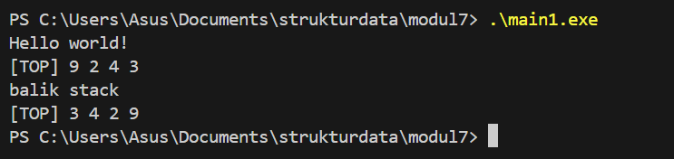
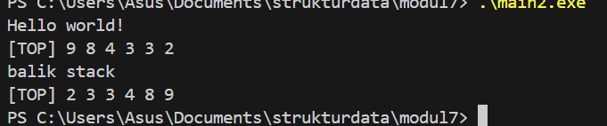
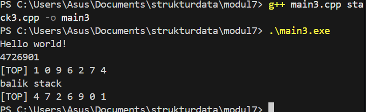

# <h1 align="center">Laporan Praktikum Modul 1 - Codeblocks IDE & Pengenalan Bahas C++ (Bagian Pertama)</h1>
<p align="center">Muhammad Dhimas Hafizh Fathurrahman - 2311102151</p>

## Dasar Teori
Stack merupakan salah satu jenis struktur data linear yang berfungsi untuk menyimpan sekumpulan data dengan menerapkan prinsip LIFO (Last In First Out). Prinsip tersebut menjelaskan bahwa data yang terakhir dimasukkan akan menjadi data pertama yang dikeluarkan[1]. Struktur data Stack memiliki bentuk menyerupai tumpukan, sehingga proses penambahan maupun pengambilan elemen hanya dapat dilakukan melalui satu sisi yang disebut TOP. Dalam pemrograman, Stack dimanfaatkan untuk berbagai kebutuhan, seperti pengolahan ekspresi matematika, pengelolaan memori, serta penerapan fitur undo dan redo[1].

### A. Konsep Dasar Stack<br/>
Stack merupakan struktur data yang mengatur penyimpanan elemen berdasarkan urutan masuk dan keluarnya data. Setiap elemen baru yang ditambahkan akan ditempatkan pada bagian paling atas tumpukan. Dengan demikian, pengaksesan elemen dilakukan melalui bagian TOP, sehingga elemen yang berada di bawahnya tidak dapat diambil sebelum elemen di atasnya dikeluarkan terlebih dahulu[1].

#### 1. Pengertian Stack
Stack atau yang dikenal sebagai struktur data tumpukan merupakan kumpulan elemen yang disusun secara berurutan dengan menggunakan prinsip LIFO (Last In First Out). Melalui prinsip tersebut, elemen yang dimasukkan paling akhir akan menjadi elemen pertama yang dikeluarkan. Penerapannya dapat dianalogikan dengan susunan piring, ketika piring yang diletakkan paling terakhir berada di posisi teratas dan akan diambil terlebih dahulu. Dalam pemrograman, Stack digunakan untuk mengatur proses penyimpanan dan pengambilan data agar berjalan secara sistematis[1].

#### 2. Komponen-Komponen Stack
Stack memiliki beberapa komponen yang berperan dalam proses pengelolaan data, yaitu TOP, Info, dan Next. TOP berfungsi sebagai penanda elemen yang berada pada posisi paling atas. Info merupakan bagian yang digunakan untuk menyimpan nilai atau informasi, sedangkan Next berperan sebagai penghubung antar-elemen melalui pointer pada representasi Linked List. Sementara itu, pada implementasi menggunakan Array, data disimpan berdasarkan indeks tertentu dan TOP menunjukkan posisi elemen terakhir yang telah dimasukkan. Setiap komponen tersebut memiliki fungsi penting dalam mendukung operasi pada Stack.

#### 3. Prinsip LIFO (Last In First Out)
LIFO merupakan aturan dasar yang menjadi karakteristik utama struktur data Stack. Aturan ini menunjukkan bahwa elemen yang dimasukkan terakhir akan dikeluarkan terlebih dahulu. Sebagai ilustrasi, apabila tiga data berupa 10, 20, dan 30 dimasukkan secara berurutan, maka angka 30 akan menempati posisi TOP dan menjadi data pertama yang diambil. Oleh karena itu, seluruh aktivitas penambahan dan pengambilan data pada Stack dilakukan melalui bagian paling atas tumpukan.

### B. Operasi dan Implementasi Stack<br/>
Stack memiliki sejumlah operasi yang digunakan untuk melakukan pengelolaan terhadap elemen yang tersimpan di dalamnya. Operasi tersebut mencakup proses memasukkan data, mengambil data, memeriksa kondisi Stack, serta menampilkan elemen yang tersimpan. Dalam penerapannya, struktur data Stack dapat dibangun menggunakan representasi Array maupun Pointer. Kedua metode tersebut mempunyai perbedaan, terutama dalam hal penyimpanan data, pengelolaan memori, dan kapasitas penyimpanan[1].

#### 1. Operasi Push dan Pop
Push adalah operasi yang berfungsi untuk memasukkan elemen baru ke dalam Stack pada posisi TOP. Ketika sebuah data ditambahkan, posisi TOP akan diperbarui agar menunjuk pada elemen yang baru dimasukkan. Sebaliknya, Pop merupakan operasi yang digunakan untuk mengambil elemen yang berada di posisi paling atas. Proses pengambilan tersebut menyebabkan posisi TOP berpindah ke elemen sebelumnya. Push dan Pop menjadi dua operasi utama yang digunakan dalam pengelolaan Stack karena keduanya menerapkan prinsip LIFO.

#### 2. Representasi Stack Menggunakan Array dan Pointer
Implementasi Stack dapat dilakukan melalui dua metode, yaitu menggunakan Array dan Pointer. Pada representasi Array, elemen disimpan dalam kumpulan indeks yang memiliki ukuran atau kapasitas tertentu, sehingga jumlah data yang dapat ditampung bergantung pada ukuran array tersebut. Sementara itu, representasi Pointer menghubungkan setiap elemen melalui alamat memori sehingga penambahan dan pengelolaan elemen dapat dilakukan secara lebih dinamis. Dengan demikian, penggunaan Array dan Linked List memiliki karakteristik masing-masing dalam proses penyimpanan serta pengaturan memori[1].

#### 3. Fungsi-Fungsi Dasar dalam Stack
Pembuatan program Stack menggunakan bahasa C++ membutuhkan beberapa fungsi dasar untuk mendukung proses pengelolaan data. Fungsi createStack() digunakan untuk menginisialisasi Stack dalam keadaan kosong, sedangkan isEmpty() berfungsi untuk mengetahui apakah Stack belum memiliki elemen. Selanjutnya, fungsi push() digunakan untuk memasukkan data dan pop() digunakan untuk mengambil elemen dari posisi TOP. Fungsi printInfo() dimanfaatkan untuk menampilkan data yang tersimpan, sementara balikStack() digunakan untuk mengubah urutan elemen menjadi terbalik. Selain itu, praktikum ini juga menerapkan pushAscending() untuk memasukkan data berdasarkan urutan menaik dan getInputStream() untuk membaca karakter masukan menggunakan cin.get().

## Guided 

### 1. stack.h

```C++
/* file : stack.h
   contoh ADT stack dengan representasi tabel */
#ifndef STACK_H_INCLUDED
#define STACK_H_INCLUDED

#include <iostream>
using namespace std;

struct infotype {
    char nim[20];
    char nama[20];
};
struct Stack {
    infotype info[10];
    int Top;
};

/* prototype */
/******** pengecekan apakah Stack kosong *********/
int isEmpty(Stack S);
/* mengembalikan nilai 0 jika stack kosong */

/******** pembuatan Stack ********/
void createStack(Stack &S);
/* I.S. sembarang
   F.S. terbentuk stack dengan Top=0 */

/******** penambahan elemen pada Stack ********/
void push(Stack &S, infotype X);
/* I.S. Stack mungkin kosong
   F.S. menambahkan elemen pada stack dengan nilai X, TOP=TOP+1 */

/******** penghapusan elemen pada Stack ********/
void pop(Stack &S, infotype &X);
/* I.S. stack tidak kosong
   F.S. nilai info pada indeks TOP disimpan pada X, kemudian TOP=TOP-1 */

/******** proses semua elemen Stack *********/
void viewStack(Stack S);
/* I.S. stack mungkin kosong
   F.S. jika stack tidak kosong menampilkan semua info yang ada pada stack
*/
#endif // STACK_H_INCLUDED
```

### 2. stack.cpp

```C++
#include "stack.h"

int isEmpty(Stack S) {
    /* Top = 0 berarti kosong, sesuai komentar di stack.h dikembalikan 0 */
    if (S.Top == 0) {
        return 0;
    } else {
        return 1;
    }
}

void createStack(Stack &S) {
    S.Top = 0;
}

void push(Stack &S, infotype X) {
    if (S.Top < 10) {
        S.Top = S.Top + 1;
        S.info[S.Top - 1] = X;   /* Top 1..10 dipetakan ke indeks array 0..9 */
    } else {
        cout << "Stack penuh, data tidak bisa ditambahkan" << endl;
    }
}

void pop(Stack &S, infotype &X) {
    if (isEmpty(S) != 0) {
        X = S.info[S.Top - 1];
        S.Top = S.Top - 1;
    } else {
        cout << "Stack kosong, tidak ada data yang bisa diambil" << endl;
    }
}

void viewStack(Stack S) {
    if (isEmpty(S) == 0) {
        cout << "Stack kosong" << endl;
    } else {
        cout << "Isi stack (dari TOP):" << endl;
        for (int i = S.Top; i >= 1; i--) {
            cout << i << ". " << S.info[i - 1].nim << " - "
                 << S.info[i - 1].nama << endl;
        }
    }
}
```


### 3. main.cpp

```C++
#include "stack.h"
#include <iostream>
#include <cstring>

using namespace std;

int main() {
    Stack S;
    infotype data, hasil;

    createStack(S);
    cout << "Stack baru dibuat, Top = " << S.Top << endl;
    viewStack(S);

    cout << endl << "--- Push 3 data ---" << endl;
    strcpy(data.nim, "103112400001");
    strcpy(data.nama, "Andi");
    push(S, data);

    strcpy(data.nim, "103112400002");
    strcpy(data.nama, "Budi");
    push(S, data);

    strcpy(data.nim, "103112400003");
    strcpy(data.nama, "Citra");
    push(S, data);
    viewStack(S);

    cout << endl << "--- Pop 1 data ---" << endl;
    pop(S, hasil);
    cout << "Data yang diambil: " << hasil.nim << " - " << hasil.nama << endl;
    viewStack(S);

    cout << endl << "--- Pop sampai kosong ---" << endl;
    pop(S, hasil);
    pop(S, hasil);
    pop(S, hasil);
    viewStack(S);

    return 0;
}
```
Program ini dibuat untuk mengelola data mahasiswa menggunakan struktur Stack berbasis Array dengan prinsip LIFO. Ketiga file saling terhubung untuk menjalankan fungsi penambahan, pengambilan, dan penampilan data berupa NIM serta nama mahasiswa.

## Unguided 

### 1. (Buatlah ADT Stack menggunakan ARRAY sebagai berikut di dalam file “stack.h”:)

### 1. stack.h
```C++

#ifndef STACK_H_INCLUDED
#define STACK_H_INCLUDED

typedef int infotype;

struct Stack {
    infotype info[20];
    int Top;
};

// Prototype fungsi
void createStack(Stack &S);
void push(Stack &S, infotype X);
infotype pop(Stack &S);
void printInfo(Stack S);
void balikStack(Stack &S);

#endif

```

### 2. stack1.cpp
```C++

#include <iostream>
#include "stack1.h"

using namespace std;

// Membuat Stack kosong
void createStack(Stack &S) {
    S.Top = 0;
}

// Menambahkan data ke Stack
void push(Stack &S, infotype X) {
    if (S.Top < 20) {
        S.info[S.Top] = X;
        S.Top++;
    } else {
        cout << "Stack penuh!" << endl;
    }
}

// Mengambil data paling atas
infotype pop(Stack &S) {
    if (S.Top > 0) {
        S.Top--;
        return S.info[S.Top];
    } else {
        cout << "Stack kosong!" << endl;
        return -1;
    }
}

// Menampilkan isi Stack
void printInfo(Stack S) {
    if (S.Top == 0) {
        cout << "Stack kosong!" << endl;
    } else {
        cout << "[TOP] ";
        for (int i = S.Top - 1; i >= 0; i--) {
            cout << S.info[i] << " ";
        }
        cout << endl;
    }
}

// Membalik urutan Stack
void balikStack(Stack &S) {
    int i = 0;
    int j = S.Top - 1;

    while (i < j) {
        infotype temp = S.info[i];
        S.info[i] = S.info[j];
        S.info[j] = temp;

        i++;
        j--;
    }
}

```

### 3. main1.cpp
```C++

#include <iostream>
#include "stack1.h"

using namespace std;

int main() {
    cout << "Hello world!" << endl;

    Stack S;

    createStack(S);

    push(S, 3);
    push(S, 4);
    push(S, 8);

    pop(S);

    push(S, 2);
    push(S, 3);

    pop(S);

    push(S, 9);

    printInfo(S);

    cout << "balik stack" << endl;

    balikStack(S);

    printInfo(S);

    return 0;
}

```
### Output Unguided 1 :



Ketiga file tersebut bekerja sama untuk menjalankan program Stack berbasis Array. main.cpp digunakan untuk menjalankan program, stack.h memuat deklarasi struktur dan fungsi, sedangkan stack.cpp berisi kode untuk mengatur proses penambahan, pengambilan, dan penampilan data mahasiswa dengan prinsip LIFO.

### 2. (Tambahkan prosedur pushAscending( in/out S : Stack, in x : integer))

### 3. stack2.h
```C++

#ifndef STACK2_H_INCLUDED
#define STACK2_H_INCLUDED

typedef int infotype;

struct Stack {
    infotype info[20];
    int Top;
};

void createStack(Stack &S);
void push(Stack &S, infotype X);
infotype pop(Stack &S);
void printInfo(Stack S);
void balikStack(Stack &S);
void pushAscending(Stack &S, infotype X);

#endif

```

### 3. stack2.cpp
```C++

#include <iostream>
#include "stack2.h"

using namespace std;

// Membuat Stack kosong
void createStack(Stack &S) {
    S.Top = 0;
}

// Menambahkan data biasa
void push(Stack &S, infotype X) {
    if (S.Top < 20) {
        S.info[S.Top] = X;
        S.Top++;
    } else {
        cout << "Stack penuh!" << endl;
    }
}

// Mengambil data paling atas
infotype pop(Stack &S) {
    if (S.Top > 0) {
        S.Top--;
        return S.info[S.Top];
    } else {
        cout << "Stack kosong!" << endl;
        return -1;
    }
}

// Menampilkan isi Stack
void printInfo(Stack S) {
    if (S.Top == 0) {
        cout << "Stack kosong!" << endl;
    } else {
        cout << "[TOP] ";
        for (int i = S.Top - 1; i >= 0; i--) {
            cout << S.info[i] << " ";
        }
        cout << endl;
    }
}

// Membalik urutan Stack
void balikStack(Stack &S) {
    int i = 0;
    int j = S.Top - 1;

    while (i < j) {
        infotype temp = S.info[i];
        S.info[i] = S.info[j];
        S.info[j] = temp;

        i++;
        j--;
    }
}

// Menambahkan data secara ascending
void pushAscending(Stack &S, infotype X) {
    if (S.Top < 20) {
        int i = S.Top;

        while (i > 0 && S.info[i - 1] > X) {
            S.info[i] = S.info[i - 1];
            i--;
        }

        S.info[i] = X;
        S.Top++;
    } else {
        cout << "Stack penuh!" << endl;
    }
}

```

### 3. main2.cpp
```C++

#include <iostream>
#include "stack2.h"

using namespace std;

int main() {
    cout << "Hello world!" << endl;

    Stack S;

    createStack(S);

    pushAscending(S, 3);
    pushAscending(S, 4);
    pushAscending(S, 8);
    pushAscending(S, 2);
    pushAscending(S, 3);
    pushAscending(S, 9);

    printInfo(S);

    cout << "balik stack" << endl;

    balikStack(S);

    printInfo(S);

    return 0;
}

```
### Output Unguided 2 :

##### Output 1


Ketiga file tersebut digunakan untuk menjalankan program Stack berbasis Array dengan fitur tambahan input data. main3.cpp berfungsi menjalankan program, stack3.h memuat deklarasi struktur dan fungsi, sedangkan stack3.cpp berisi proses penambahan, pengambilan, pembalikan, serta pembacaan angka hingga pengguna menekan Enter

### 3. (ambahkan prosedur getInputStream( in/out S : Stack ). Prosedur akan terus membaca dan
menerima input user dan memasukkan setiap input ke dalam stack hingga user menekan
tombol enter. Contoh: gunakan cin.get() untuk mendapatkan inputan user.)

### 3. stack3.h
```C++

#ifndef STACK3_H_INCLUDED
#define STACK3_H_INCLUDED

typedef int infotype;

struct Stack {
    infotype info[20];
    int Top;
};

void createStack(Stack &S);
void push(Stack &S, infotype X);
infotype pop(Stack &S);
void printInfo(Stack S);
void balikStack(Stack &S);
void getInputStream(Stack &S);

#endif

```

### 3. stack3.cpp
```C++

#include <iostream>
#include "stack3.h"

using namespace std;

void createStack(Stack &S) {
    S.Top = 0;
}

void push(Stack &S, infotype X) {
    if (S.Top < 20) {
        S.info[S.Top] = X;
        S.Top++;
    }
}

infotype pop(Stack &S) {
    if (S.Top > 0) {
        S.Top--;
        return S.info[S.Top];
    }
    return -1;
}

void printInfo(Stack S) {
    if (S.Top == 0) {
        cout << "Stack kosong!" << endl;
    } else {
        cout << "[TOP] ";
        for (int i = S.Top - 1; i >= 0; i--) {
            cout << S.info[i] << " ";
        }
        cout << endl;
    }
}

void balikStack(Stack &S) {
    int i = 0;
    int j = S.Top - 1;

    while (i < j) {
        infotype temp = S.info[i];
        S.info[i] = S.info[j];
        S.info[j] = temp;

        i++;
        j--;
    }
}

void getInputStream(Stack &S) {
    char input;

    while (cin.get(input) && input != '\n') {
        if (input >= '0' && input <= '9') {
            push(S, input - '0');
        }
    }
}

```

### 3. main3.cpp
```C++

#include <iostream>
#include "stack3.h"

using namespace std;

int main() {
    cout << "Hello world!" << endl;

    Stack S;

    createStack(S);

    getInputStream(S);

    printInfo(S);

    cout << "balik stack" << endl;

    balikStack(S);

    printInfo(S);

    return 0;
}

```
### Output Unguided 3 :

##### Output 1



Ketiga file tersebut digunakan untuk membuat program Stack berbasis Array yang dilengkapi fitur memasukkan angka. main3.cpp berperan menjalankan program, stack3.h berisi deklarasi struktur dan fungsi, sementara stack3.cpp mengatur proses penambahan, pengambilan, pembalikan data, serta penerimaan input hingga tombol Enter ditekan.

## Kesimpulan
Dari hasil praktikum, dapat diketahui bahwa Stack merupakan struktur data yang menerapkan prinsip LIFO (Last In First Out), di mana data yang terakhir dimasukkan akan dikeluarkan lebih dahulu. Praktikum ini membahas penggunaan Stack dengan Array, mulai dari membuat Stack, menambahkan data (Push), mengambil data (Pop), hingga menampilkan isi Stack. Selain itu, dipelajari juga cara mengurutkan, membalikkan data, dan menerima input dari pengguna menggunakan program C++.

## Referensi
**Referensi**

[1] Setiyawan, R. D., Hermawan, D., Abdillah, A. F., Mujayanah, A., & Vindua, R. (2024). Penggunaan struktur data stack dalam pemrograman C++ dengan pendekatan array dan linked list. *JUTECH: Journal Education and Technology, 5*(2), 484–498. [https://doi.org/10.31932/jutech.v5i2.4263](https://doi.org/10.31932/jutech.v5i2.4263)

<br>...
